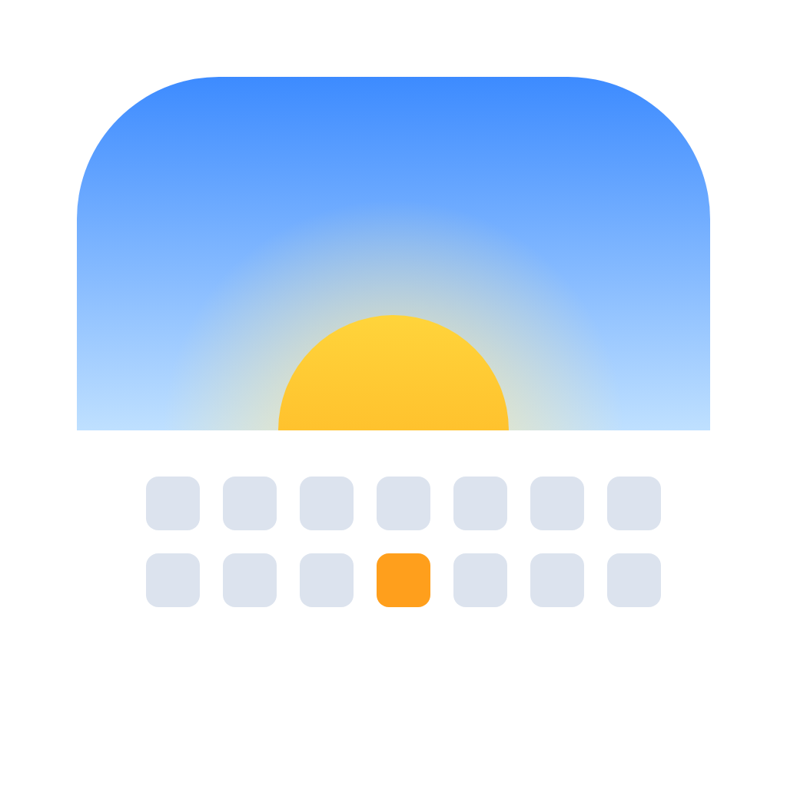
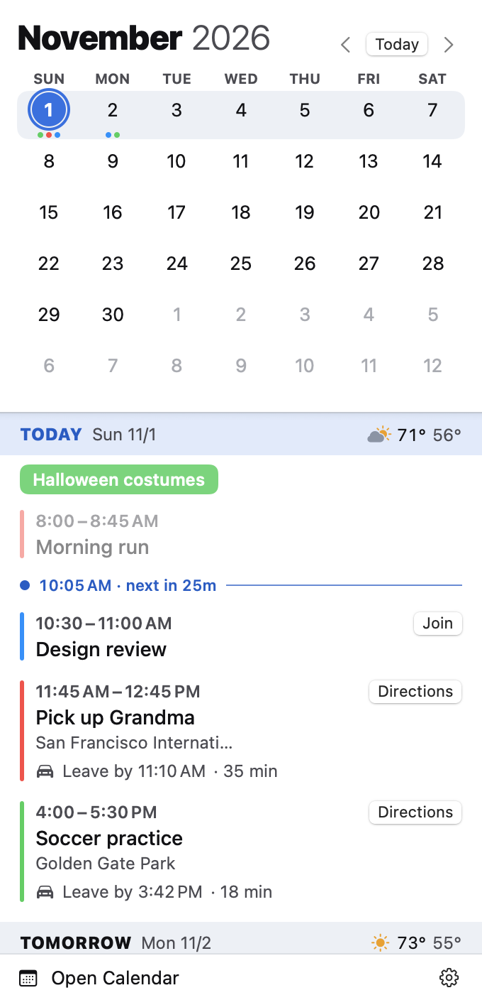
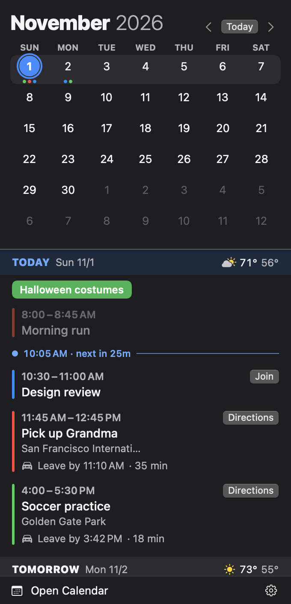
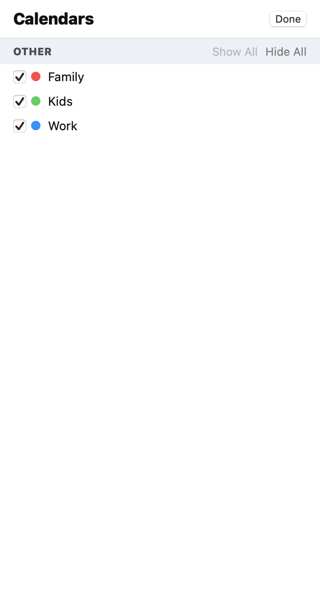
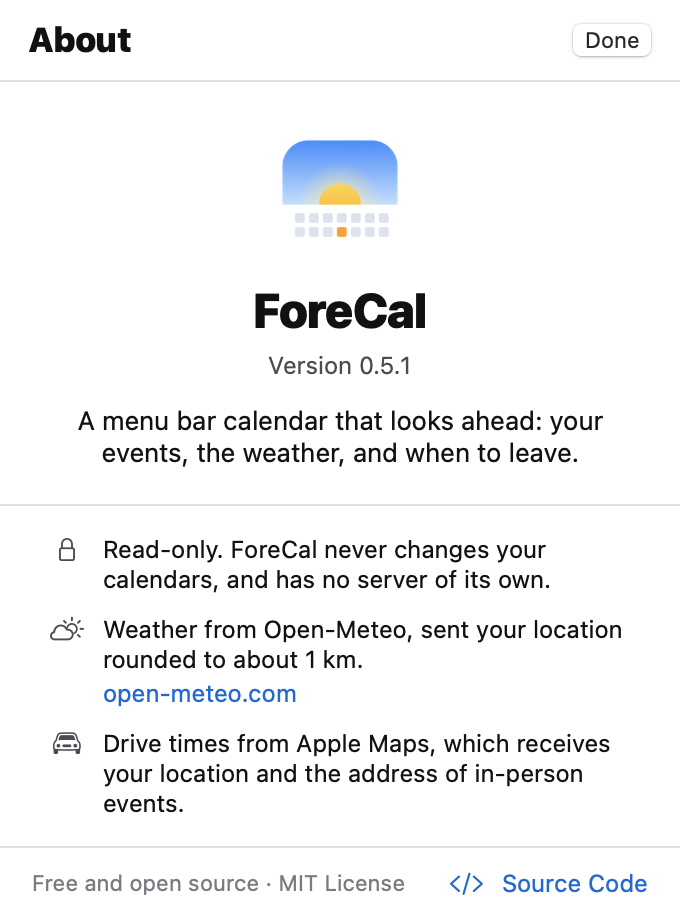

# ForeCal

A menu bar calendar for macOS that looks ahead: your events, the weather, and
when to leave.

ForeCal is free, open source, and read-only. It shows the calendars you already
have in macOS Calendar (iCloud, Google, Exchange, CalDAV, and subscribed
calendars) and never changes them.

**Website:** [chuckconway.github.io/forecal](https://chuckconway.github.io/forecal) · **[User Guide](https://chuckconway.github.io/forecal/guide.html)**

<p align="center">
  
  &nbsp;
  
</p>

## Contents

- [Features](#features)
- [Install](#install)
- [Using ForeCal](#using-forecal)
- [Privacy](#privacy)
- [Troubleshooting](#troubleshooting)
- [Build from source](#build-from-source)
- [Contributing](#contributing)
- [Roadmap](#roadmap)
- [License](#license)

## Features

### What's next, in the menu bar

The menu bar item shows today's date and, when something is coming up, a short
status in this order of priority:

| Status | When |
|---|---|
| 🚗 **Leave in 12m** / **Leave now** | An in-person event's leave-by time is within 30 minutes. |
| **Design review · 25m** / **· now** | An event starts within 30 minutes. |
| **Planning · ends 3:00 PM** | You're in an event (blocks of 8 hours or more, like "Work", are skipped). |

Declined and canceled events never show. The status updates on the minute, and
catches up right away when your Mac wakes.

### Leave-by times and directions

In-person events in the next 48 hours get a drive time from where you are, using
Apple Maps with current traffic. The event shows a badge such as
**Leave by 8:33 AM · 42 min**, which turns orange within the hour, and a
**Directions** button that opens the route in Maps.

- Drive times refresh every 10 minutes for events in the next two hours, and
  hourly otherwise, or as soon as you move more than 1 km.
- An event counts as in person when its location reads as a place. Locations
  that are links or that mention Zoom, Teams, Google Meet, Webex, FaceTime,
  online, virtual, phone, conference call, room, TBD, or TBA are skipped.
- Trips under 5 minutes (you're already there) or over 4 hours (probably a
  flight or a wrong match) don't get a badge.

### Weather

Each day in the agenda shows its forecast: an icon, the high and low, and the
chance of rain when it's 30% or more. Forecasts reach 16 days out, in °F or °C
to match your region.

### Join buttons

Events with a video call link in the URL, location, or notes get a **Join**
button: Zoom, Google Meet, Microsoft Teams, Webex, FaceTime, Whereby, Amazon
Chime, and GoToMeeting.

### Month grid and agenda, in sync

- The agenda scrolls continuously a year back and a year ahead. Day headers stay
  pinned at the top while you scroll.
- Scroll the agenda and the grid follows; click a day in the grid and the
  agenda jumps to it.
- Dots under each date show which calendars have events that day.
- Hover over an event and its day is ringed in the grid, in the event's
  calendar color.
- Today's list has a now line with the time until your next event. Past events
  are dimmed.
- Click an event to expand it: calendar, attendees, notes, and link.

### Your choices

From the gear menu: which calendars to show, the color for today (red, blue, or
indigo), and whether ForeCal starts when you log in. Light and dark mode follow
your system.

<p align="center">
  
  &nbsp;
  
</p>

## Install

**Requires macOS 14 Sonoma or later.**

**[Download ForeCal](https://github.com/chuckconway/forecal/releases/latest/download/ForeCal.zip)** (signed and notarized by Apple, for Apple
silicon and Intel), open the zip, and drag ForeCal into Applications. Older
versions are on the [releases page](https://github.com/chuckconway/forecal/releases).
You can also [build from source](#build-from-source).

The first time ForeCal runs, it asks for two permissions:

- **Calendars (required):** to show your events. Choose **Allow Full Access**.
- **Location (optional):** for weather and drive times. Without it, everything
  else works.

ForeCal lives in the menu bar only, with no Dock icon. To quit, open it and
choose **Quit ForeCal** from the gear menu.

## Using ForeCal

| To | Do this |
|---|---|
| Open ForeCal | Click the date in the menu bar. |
| See another month | Click **‹** or **›** next to the month, or scroll the agenda. |
| Go back to today | Click **Today**. |
| Jump to a day | Click it in the grid. |
| See an event's details | Click the event. Click again to collapse it. |
| Join a call | Click **Join** on the event. |
| Get directions | Click **Directions** on the event. |
| Open macOS Calendar | Click **Open Calendar** at the bottom. |
| Hide or show calendars | Gear menu › **Choose Calendars…** |
| Change today's color | Gear menu › **Today Color** |
| Start at login | Gear menu › **Launch at Login** |
| See the version and credits | Gear menu › **About ForeCal** |

## Privacy

ForeCal has no server, account, analytics, or tracking. Two things leave your
Mac:

- **Weather:** your location, rounded to about 1 km, goes to
  [Open-Meteo](https://open-meteo.com) about once an hour.
- **Drive times:** your location and the addresses of in-person events in the
  next 48 hours go to Apple Maps.

Event titles, notes, attendees, and everything else stay on your Mac. ForeCal
only reads your calendars; it never creates, changes, or deletes events.

ForeCal runs in Apple's App Sandbox, so macOS itself limits it to your
calendars, your location, and the network.

## Troubleshooting

**"ForeCal needs calendar access."** Open System Settings › Privacy & Security
› Calendars and turn on **Full Access** for ForeCal. The panel has a button that
takes you there.

**No weather.** ForeCal needs your location. Check System Settings › Privacy &
Security › Location Services, and that your Mac is online.

**No leave-by time on an event.** It needs location access, and the event has
to be timed (not all-day), within the next 48 hours, at a place rather than a
call, and between 5 minutes and 4 hours away by car. If Apple Maps can't find
the address, there's no badge; a fuller address usually fixes it.

**A calendar is missing.** Check the gear menu › **Choose Calendars…** It's
also worth checking that macOS Calendar shows it: ForeCal sees what Calendar
sees.

## Build from source

You need Xcode or the Command Line Tools (`xcode-select --install`).

```sh
git clone https://github.com/chuckconway/forecal.git
cd forecal
./build.sh --install   # builds build/ForeCal.app, copies it to ~/Applications, and opens it
```

Local builds are signed ad hoc by default, which macOS treats as a new app each
time: expect the calendar and location prompts again after every rebuild. To
keep permissions across rebuilds, create a self-signed code-signing certificate
in Keychain Access and put its name in a `.signing-identity` file at the repo
root (it's gitignored).

### Tests

```sh
./test.sh
```

The tests use Swift Testing and cover the logic with rules behind it: the menu
bar status and its priorities, which events count as in person, meeting links,
weather decoding and location rounding, and how multi-day events land on days.
`test.sh` works with full Xcode or just the Command Line Tools. GitHub Actions
runs it on every push and pull request.

### Screenshots without your own data

```sh
./build.sh --snapshot <dir>
```

Renders the panel offscreen with sample events, in light and dark, and writes
PNGs to `<dir>`. It never touches your calendars or asks for permissions, so
it runs from an unsandboxed copy of the app that can write anywhere. The
screenshots here come from it.

### Releases

`./build.sh --release` runs the tests, signs with a Developer ID certificate
and the hardened runtime, notarizes with Apple, staples the ticket, and writes
`build/ForeCal.zip`. It expects a `notarytool` keychain profile named `ForeCal`.

`./build.sh --appstore` runs the tests, signs for the Mac App Store, and writes
`build/ForeCal.pkg` to upload with Transporter. It needs Apple Distribution and
Mac Installer Distribution certificates in the keychain, and the Mac App Store
provisioning profile at `AppStore.provisionprofile` (gitignored). Both builds
set the build number to the commit count, so each upload is higher than the
last.

`Resources/appstore/make-screenshots.sh` renders the App Store screenshots
(2880 × 1800) into `build/appstore-screenshots`, from snapshot mode.

### Icon

The icon is drawn in `Resources/icon/AppIcon.svg` (and `AppIcon-Dark.svg`, shown
in the About screen in dark mode). `Resources/icon/make-icon.sh` renders them
with Google Chrome into the app icon and the About images.

### Project layout

| Path | What's there |
|---|---|
| `Sources/ForeCal/` | The app (SwiftUI, EventKit, MapKit, CoreLocation). No dependencies. |
| `Tests/ForeCalTests/` | Tests. |
| `Resources/` | Info.plist, entitlements, icons. |
| `docs/` | README images and the website. |
| `build.sh`, `test.sh` | Build, install, release, and test. |

## Contributing

Issues and pull requests are welcome. For anything bigger than a small fix,
open an issue first so we can agree on the approach. Please run `./test.sh`
before sending a pull request, and add a test when you change logic.

ForeCal is deliberately read-only and has no server; changes that would alter
either are out of scope.

## Roadmap

See [ROADMAP.md](ROADMAP.md).

## License

[MIT](LICENSE). Weather data by [Open-Meteo](https://open-meteo.com), licensed
under [CC BY 4.0](https://creativecommons.org/licenses/by/4.0/).
